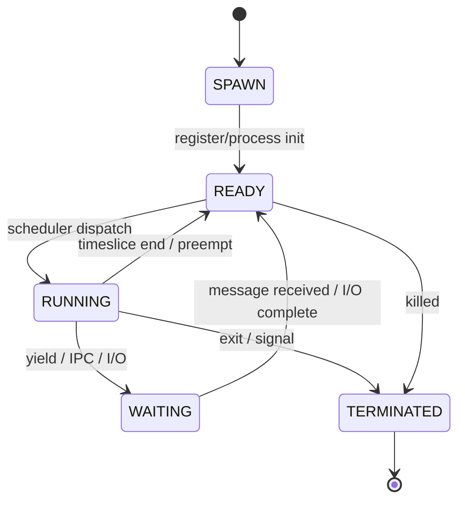

# 01 // KERNEL SPECIFICATION & PCB SCHEMA

This document specifies the Process Control Block (PCB) used by Portal-OS1 and the microkernel lifecycle. The PCB is the canonical, versioned snapshot for every active agent/task.

## Goals
- Provide a stable, machine-validated PCB shape for storage and IPC.
- Make lifecycle states and transitions explicit.
- Clarify storage and operational requirements (D1 snapshots, retention, etc.).

## PCB Data Schema (human-readable example)

Schema version: 1

```json
{
  "schema_version": 1,
  "process_id": "proc_9f8a10b2",
  "owner_id": "user_max",
  "parent_process_id": null,
  "status": "RUNNING",
  "priority": 1,
  "scheduling_policy": "RR",
  "heap_usage_bytes": 524288,
  "stack_usage_bytes": 65536,
  "cpu_time_ms": 1250,
  "created_at": "2026-10-18T12:00:00Z",
  "updated_at": "2026-10-18T12:05:00Z",
  "last_heartbeat_at": "2026-10-18T12:05:00Z",
  "metadata": {
    "entry_point": "/agents/my-agent",
    "labels": ["network", "priority-high"]
  }
}
```

Notes:
- Use bytes for memory fields (`heap_usage_bytes`, `stack_usage_bytes`) to avoid ambiguity. If KB is required, record units explicitly (e.g., `heap_usage_kb` + unit).
- `process_id` may follow your internal pattern (proc_[hex]) or be an RFC4122 UUID. Pick one and validate.
- `schema_version` permits future evolution without breaking deserializers.
- `priority` and `scheduling_policy` should be normalized across the scheduler and documented (e.g., priority 0..255, or -20..19).

## JSON Schema (Draft)

Use this JSON Schema to validate PCB objects before persistence or IPC.

```json
{
  "$schema": "http://json-schema.org/draft-07/schema#",
  "title": "Portal-OS1 PCB",
  "type": "object",
  "required": ["schema_version", "process_id", "owner_id", "status", "priority", "created_at", "updated_at"],
  "additionalProperties": false,
  "properties": {
    "schema_version": { "type": "integer", "minimum": 1 },
    "process_id": { "type": "string", "pattern": "^(proc_[0-9a-f]{8}|[0-9a-fA-F-]{36})$" },
    "owner_id": { "type": "string", "minLength": 1 },
    "parent_process_id": { "type": ["string", "null"] },
    "status": {
      "type": "string",
      "enum": ["SPAWN", "READY", "RUNNING", "WAITING", "TERMINATED", "SUSPENDED"]
    },
    "priority": { "type": "integer", "minimum": 0, "maximum": 255 },
    "scheduling_policy": { "type": "string", "enum": ["FIFO", "RR", "PRIORITY"], "default": "RR" },
    "heap_usage_bytes": { "type": "integer", "minimum": 0 },
    "stack_usage_bytes": { "type": "integer", "minimum": 0 },
    "cpu_time_ms": { "type": "integer", "minimum": 0 },
    "created_at": { "type": "string", "format": "date-time" },
    "updated_at": { "type": "string", "format": "date-time" },
    "last_heartbeat_at": { "type": ["string", "null"], "format": "date-time" },
    "metadata": { "type": "object", "additionalProperties": true }
  }
}
```

Recommendation: register and enforce this schema in the agent sandbox serialization step and in D1 write/restore logic.

## Microkernel Lifecycle (state machine)

Use an explicit state machine. Below is a Mermaid diagram to include in documentation and to generate visuals automatically.



State definitions (short):
- SPAWN: Kernel has allocated a process_id and PCB entry. Initialization occurs here.
- READY: Enqueued and eligible for scheduling.
- RUNNING: Actively executing inside the Durable Object sandbox.
- WAITING: Blocked on IPC or external I/O.
- TERMINATED: Completed or aborted — resources eligible for reclamation.

Micro-tick yields: a running process may voluntarily yield or be preempted; ensure transitions back to READY are logged.

## Durable storage (D1) and snapshots
- D1 is the durable store for PCB snapshots ( clarify: "D1" = Durable Object / Durable storage system used by Portal-OS1).
- Recommendation:
  - Always write the PCB after important lifecycle events: SPAWN -> READY, READY -> RUNNING (first dispatch), RUNNING -> WAITING, RUNNING -> TERMINATED.
  - Use optimistic concurrency control: include a revision or updated_at guarded write to prevent lost updates from concurrent scheduler actions.
  - Keep an audit log for state transitions (small append-only log keyed by process_id + timestamp) separate from the latest PCB snapshot for troubleshooting.

## Observability and telemetry
- Emit events for transitions with (process_id, from_status, to_status, timestamp, reason).
- Track metrics: process_count_by_state, avg_cpu_time_ms, memory_usage_histogram.
- Export last_heartbeat_at and mark stale processes after a configurable timeout.

## Security and access control
- Only the kernel scheduler and trusted agent supervisor may update PCB fields like `status`, `priority`, or memory usage.
- `owner_id` must be an authenticated principal; do not allow arbitrary clients to claim ownership.
- Sanitize user-supplied `metadata` before logging.

## Testing and validation
- Unit tests:
  - PCB JSON serialize/deserialize round-trip.
  - Schema validation rejects missing required fields and invalid timestamps/patterns.
  - Transition tests: invalid transitions are rejected by the scheduler (e.g., TERMINATED -> READY).
- Integration tests:
  - Scheduler snapshot/restore from D1 during restart.
  - Observer/metric pipelines receiving transition events.

## Backwards compatibility
- Increment `schema_version` when making incompatible changes.
- Provide a migration path and tests for upgrading from older schema versions.

## Examples of common operations
- Create (SPAWN -> READY): allocate id, persist PCB, push to READY queue.
- Dispatch (READY -> RUNNING): scheduler updates PCB.updated_at, sets RUNNING.
- Yield (RUNNING -> WAITING): persist snapshot, register wait reason.
- Terminate (RUNNING -> TERMINATED): persist final snapshot, emit termination event with exit_code.

---

Appendix: abbreviations
- D1 — durable storage instance (define the concrete product or service used in architecture docs).
- PCB — Process Control Block (the per-process state snapshot).
